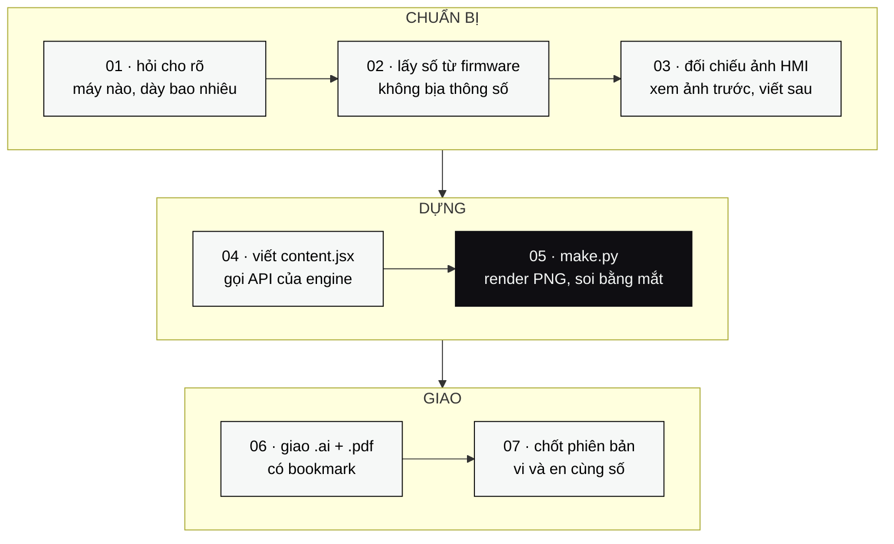

<samp>

[](#yêu-cầu-máy)
[](#api-của-engine)
[](#một-lệnh)
[](#yêu-cầu-máy)
[](#dùng-làm-agent-skill)
[](#lái-illustrator-bằng-câu-lệnh)
[](#bookmark-không-có-là-chưa-xong)

</samp>

**bộ dàn trang tài liệu hướng dẫn máy rang cà phê — chạy thẳng trong Adobe Illustrator.**
Viết nội dung bằng JavaScript, máy tự dàn trang A4 đúng chuẩn bộ manual O Tesla: bìa, mục lục
tự đánh số trang, hộp cảnh báo ISO 3864, bảng tự lặp tiêu đề, ảnh có khung chú thích đánh số,
và bookmark gắn thẳng vào PDF.

<samp>a4 595.28 × 841.89 pt · 280 trang / tài liệu · song ngữ vi + en · xuất .ai và .pdf</samp>

---

## vì sao có kho này

Mỗi máy rang giao đi phải kèm một quyển hướng dẫn. Dàn tay trong Illustrator thì một chương
15 trang mất cả buổi, và lần sau sửa một dòng là phải đẩy lại toàn bộ bố cục bên dưới.

Kho này chứa **engine dàn trang** + **skill cho trợ lý AI**. Người viết chỉ lo nội dung:

```javascript
COVER("HƯỚNG DẪN SỬ DỤNG", "Chức năng làm nóng máy", "Máy rang OTL-06 / OTL-12",
      "O TESLA INDUSTRY", "Phiên bản 1.0");
COMPANY("CÔNG TY TNHH CÔNG NGHIỆP O TESLA", "Nhà sản xuất máy rang cà phê", thongTin, luuY1, luuY2);
TOCRESERVE();

chapterHeader = "Làm nóng máy"; addPage();
H1("3  LÀM NÓNG MÁY TRƯỚC KHI RANG");
H2(1, "Khi nào cần làm nóng");
P("Máy nguội qua đêm phải được làm nóng trước mẻ đầu tiên…");
SAFETY("canhbao", "BỀ MẶT NÓNG",
       "Vỏ trống và ống khói đạt trên **200 °C**.\n- Không chạm tay trần\n- Đeo găng chịu nhiệt");
TABLE(["Bước", "Việc phải làm", "Thời gian"], rows, [70, 280, 85.28]);
P("Bảng tra nhiệt ở trang {{c5}}.");          // số trang tự điền

TOCDRAW("MỤC LỤC", "PH-");
var msg = XUAT(base, "OTL_Preheat_VI");
```

Engine tự đo chiều cao từng khối chữ, tự sang trang, tự điền số trang vào mục lục và vào mọi
mốc `{{…}}` rải trong bài. **Không ai phải tính toạ độ `y` bằng tay.**


---

## một lệnh

Đứng ở thư mục chứa file nội dung:

```bash
python <skill>/assets/make.py content.jsx
python <skill>/assets/make.py content.jsx content-en.jsx   # nhiều bản, chung một phiên
python <skill>/assets/make.py content.jsx --nhanh          # bản nháp, bỏ lưu .ai
python <skill>/assets/make.py content.jsx --giao --mo      # chép .pdf/.ai ra ngoài + mở xem
```

`make.py` làm liền một mạch, không phải nhớ bước nào:

| | việc máy tự làm |
|---|---|
| `01` | nối `engine.jsx` + nội dung, chạy Illustrator qua COM (một phiên cho mọi file) |
| `02` | lưu `.ai` + `.pdf` nén ảnh 200 dpi |
| `03` | **gắn bookmark** vào PDF rồi đọc lại chính file đó để soát |
| `04` | kiểm xuống dòng tiếng Việt — chữ mồ côi, số rời đơn vị, cụm trong ngoặc bị cắt |
| `05` | render PNG từng trang, ghép **tờ soát 12 trang/tờ** để soi bố cục cả tài liệu |
| `06` | rà trang thưa chữ, báo mốc trang sai tên, cảnh báo chỗ thiếu dấu cách trước `–` |
| `07` | gặp lỗi `PARM` của Illustrator thì tự thoát Illustrator và dựng lại một lần |

```
== content.jsx
  OK pages=15
  bookmark=20 (soat lai tren file: 20)
  xuong dong: SACH
  khong co trang thua chu
```

> [!IMPORTANT]
> **`OK pages=N` không có nghĩa là tài liệu xong.** Máy chỉ rà được trang thưa chữ. Chồng chữ,
> tràn khung, logo chạm tiêu đề thì nó không thấy — phải render PNG và **soi bằng mắt** rồi mới
> được nói là xong.

### thời gian thật — tài liệu 15 trang, đo 30/09/2026

| khâu | |
|---|---|
| Illustrator khởi động nguội | **~32 s** — chỉ tốn một lần, đừng tắt giữa chừng |
| vẽ 15 trang | ~4 s |
| lưu `.ai` | ~1,2 s |
| lưu `.pdf` | ~1,0 s |
| render PNG + rà soát | ~0,5 s |

Cả tài liệu: **17 s → 11 s** sau khi gộp phiên COM (`--nhanh`: **9 s**).

---

## bookmark — không có là chưa xong

Illustrator xuất PDF từ artboard nên **không bao giờ tự sinh bookmark**. Không gắn thì người
đọc phải kéo 17 trang để tìm mục 3.3.

`assets/bookmark.py` đọc lại chính file PDF, lọc chữ **Arial Bold 19 pt** làm mục 1 và
**12,5 pt** làm mục 2, đánh số 3.1 / 3.2 … đúng như huy hiệu tròn mà engine vẽ:

```bash
python assets/bookmark.py tai-lieu.pdf
```

`make.py` gọi sẵn sau mỗi lần lưu PDF. Dòng `bookmark=0` là **chưa xong, không được giao**.

---

## xuống dòng thông minh cho tiếng Việt

`mkText()` dựng chữ xong thì đọc lại từng dòng Illustrator đã ngắt, gặp chỗ xấu thì chèn xuống
dòng mềm trước chữ cuối của dòng trên, lặp tới khi sạch. Năm kiểu bị bắt:

| | |
|---|---|
| chữ mồ côi | `chương ⏎ 3.` · dòng cuối ≤ 2 chữ mà ≤ 12 ký tự |
| số rời đơn vị | `90 ⏎ °C` · `4–6 ⏎ mẻ` |
| tiền tố rời số | `Hình ⏎ 4.1` · `mục ⏎ 2.1` |
| cụm trong ngoặc bị cắt | `(hai ⏎ ô 3 số)` |
| dấu câu đứng đầu dòng | dòng mới bắt đầu bằng `–` |

Áp cho mọi khung rộng hơn 30 pt, kể cả ô bảng. Tắt bằng `SMARTBREAK = false`.

> [!CAUTION]
> **Đừng quay lại U+00A0 hay `noBreak`.** Đo thật 07/10/2026: Illustrator **vẫn ngắt** ở U+00A0;
> còn `characterAttributes.noBreak = true` thì giữ được chữ nhưng để nó **tràn ra ngoài lề phải**.

---

## chạy thử

<a id="yêu-cầu-máy"></a>

| thứ cần có | ghi chú |
|---|---|
| Adobe Illustrator | CC 24 trở lên, đã chạy ít nhất một lần |
| Windows PowerShell | để gọi COM `Illustrator.Application` |
| font Arial | có đủ dấu tiếng Việt — **Arial Black thì không**, đừng dùng cho tiêu đề tiếng Việt |
| Python + PyMuPDF | `pip install pymupdf` — gắn bookmark và render PDF ra PNG |
| Pillow | `pip install pillow` — ghép tờ soát bố cục |

Nhanh nhất là chạy `make.py`. Muốn làm tay từng bước để gỡ lỗi:

```bash
cat skill/manual-otl/assets/engine.jsx content.jsx > manual.jsx
```
```powershell
$ai = New-Object -ComObject Illustrator.Application
while ($ai.Documents.Count -gt 0) { $ai.ActiveDocument.Close(2) }   # dọn doc lỗi của lần trước
$ai.DoJavaScriptFile("C:\OTL\manual\build\manual.jsx")
```
```bash
python -c "import fitz; d=fitz.open('ten.pdf'); [d[i].get_pixmap(dpi=78).save('p_%02d.png' % (i+1)) for i in range(d.page_count)]"
```

Ảnh nào chưa có thì engine vẽ ô nét đứt thay chỗ — tài liệu vẫn dựng được khi ảnh chưa đủ.

---

## bảy bước làm một chương



Bước 05 là bắt buộc. Lỗi tràn khung và chồng chữ **không bao giờ hiện ra trong log**.

---

## lái Illustrator bằng câu lệnh

Engine dàn trang chạy được mà không cần MCP. Nhưng khi làm **bìa, banner, sơ đồ, ảnh minh hoạ**
— những thứ phải nhìn rồi sửa — thì để trợ lý đọc thẳng tài liệu đang mở sẽ nhanh hơn nhiều.

```bash
claude mcp add illustrator --scope user -- npx -y illustrator-mcp-server
```

Máy chủ dùng ở đây là [`illustrator-mcp-server`](https://github.com/ie3jp/illustrator-mcp-server)
của ie3jp (MIT, 66 tool) — kho này **không chép lại mã nguồn** của gói đó, `npx` tự tải về.
Cấu hình dán sẵn, bảng tool chia theo việc, và ranh giới *khi nào dùng MCP · khi nào phải viết
JSX chạy qua COM* nằm ở **[`mcp/README.md`](mcp/README.md)**.

> [!CAUTION]
> **Đặt màu chữ qua MCP không ăn.** `create_text_frame(fill=…)` chỉ tô *khung* text, từng ký tự
> vẫn đen — xuất ra mới biết. Màu chữ, gradient, khoét hình: viết `.jsx` rồi chạy qua COM.
> Bốn bẫy đầy đủ ở [`mcp/README.md`](mcp/README.md#bốn-bẫy-đã-trả-giá).

---

## api của engine

| hàm | dùng để |
|---|---|
| `COVER(kicker, title, subtitle, machine, footline)` | trang bìa — gọi **đầu tiên**, thay cho `newDoc()` |
| `coverImage` · `LOGO` · `LOGO_W_COVER` · `FOOTLINE` | ảnh máy trên bìa · logo · bề ngang logo · dòng bản quyền chân trang |
| `COMPANY(tên, mô_tả, [[nhãn, giá_trị], …], tiêu_đề_lưu_ý, thân_lưu_ý)` | trang thông tin nhà sản xuất |
| `TOCRESERVE()` … `TOCDRAW(tiêu_đề, "PH-")` | mục lục — giữ chỗ ngay sau trang công ty, số trang tự điền từ các `H1` |
| `PGPREFIX = "AV-"` | tiền tố số trang ở chân trang — **tài liệu mới phải đặt lại** |
| `chapterHeader = "…"; addPage();` | sang trang mới — gán header **trước** `addPage` |
| `H1` · `H2(số, chữ)` · `H3` · `H3TAG(nhãn, chữ)` | tiêu đề chương · mục có huy hiệu tròn · tiêu đề nhỏ · tiêu đề có nhãn phiên bản máy |
| `P` · `PI` · `BUL([…])` | đoạn canh đều · ghi chú nghiêng xám · danh sách gạch đầu dòng |
| `STEP(n, chữ)` · `STEPIMG(n, chữ, file, chữ_sau, rộng)` | bước đánh số · bước có ảnh nút bấm bên dưới |
| `IMG(file, rộng, chú_thích)` | ảnh căn giữa |
| `IMGC(file, rộng, chú_thích, marks, legend)` | ảnh + khung đỏ đánh số; `marks=[[x,y,w,h,"1"],…]` theo **tỉ lệ 0–1** |
| `IMG2(fileA, fileB, cao_max, ctA, ctB)` | hai ảnh cạnh nhau **cùng chiều cao** — ảnh dọc, so sánh trước/sau |
| `ICONROW([[file, chú_thích], …])` | hàng biển ISO 7010 có chú thích |
| `TABLE(cols, rows, widths, [opts])` | bảng — tổng `widths` = 435.28, tự lặp hàng tiêu đề khi sang trang; `{grid: true}` cho phiếu ký tay |
| `SAFETY(loại, tiêu_đề, thân, [biển])` | hộp cảnh báo 4 cấp, kèm biển ISO 7010 đặt dọc bên trái |
| `STATEFLOW([[tên, mô_tả, thời_gian], …])` | sơ đồ các bước nối bằng mũi tên |
| `RULE()` · `GAPV(h)` | đường kẻ ngang · chừa khoảng trắng |
| `**chữ**` trong mọi chuỗi | in đậm đúng mấy chữ đó — kể cả trong ô bảng và hộp cảnh báo |
| `{{c3}}` · `ANCHOR("ten")` | **số trang tự điền** ở bất kỳ chuỗi nào; mốc sai tên in `??` và `make.py` báo lỗi |
| `XUAT(base, "Ten-file")` | dòng cuối content — điền số trang, lưu `.ai` + `.pdf`, trả kết quả cho `make.py` |

---

## bảng màu

| | rgb | dùng ở |
|---|---|---|
|  `#2E74B5` | `46, 116, 181` | xanh OTL — header, footer, tiêu đề bảng |
|  `#4A87C7` | `74, 135, 199` | xanh huy hiệu — số mục, sơ đồ trạng thái |
|  `#C00000` | `192, 0, 0` | đỏ — hộp NGUY HIỂM, khung chú thích trên ảnh |
|  `#E26C0A` | `226, 108, 10` | cam — hộp CẢNH BÁO |
|  `#FFC000` | `255, 192, 0` | vàng — hộp THẬN TRỌNG (chữ tiêu đề đen) |
|  `#232323` | `35, 35, 35` | chữ thân bài |

### bốn cấp cảnh báo — iso 3864 / ansi z535

| cấp | màu | khi nào dùng |
|---|---|---|
| **NGUY HIỂM** | đỏ | chết người hoặc thương tích nặng, gần như chắc chắn xảy ra nếu làm sai — ví dụ nổ khí gas |
| **CẢNH BÁO** | cam | có thể chết người hoặc thương tích nặng — bề mặt nóng, máy tự khởi động |
| **THẬN TRỌNG** | vàng | thương tích nhẹ hoặc hỏng máy |
| **LƯU Ý** | xanh | không nguy hiểm, chỉ ảnh hưởng chất lượng mẻ rang hoặc tuổi thọ máy — **không có tam giác** (ISO 3864-2) |

Mỗi hộp viết **hậu quả trước**, rồi mới tới các gạch đầu dòng nêu việc phải làm.

---

## bẫy đã trả giá

> [!CAUTION]
> **Canvas của Illustrator chỉ 16384 pt.** Xếp artboard một hàng ngang là gãy từ trang 13 với
> lỗi `AOoC`. Engine mặc định lưới `OX = -7700, OY = 4500, COLS = 20` → chứa **280 trang**.
> Đừng đẩy `OY` sát mép trên: hàm đo chiều cao chữ đặt khung tạm ở `y = -3000…-4000`.

> [!WARNING]
> **Không sửa file `.jsx` tiếng Việt bằng `sed` hay `perl -i`** — hỏng encoding UTF-8 và nuốt
> escape `\uXXXX`. Ghi lại nguyên file bằng Python đọc/ghi UTF-8. Công cụ sửa từng dòng cũng hay
> **cắt khoảng trắng cuối chuỗi**: mất một dấu cách là bìa in ra `2.1– 09/2026` dính chữ.

> [!NOTE]
> - `textFrame.paragraphs[0]` ném lỗi **1302** khi khung chữ rỗng → bọc `try/catch` quanh `textRange.paragraphAttributes`.
> - `position` của text frame là **góc trái-trên**, không phải baseline — tính theo baseline là chữ tụt nửa dòng khỏi thanh màu.
> - Chữ canh đều phải dùng `FULLJUSTIFYLASTLINELEFT`, không phải `FULLJUSTIFY`.
> - Tiêu đề mồ côi: `H2` dự phòng **200 pt**, `H3` **150 pt** — thấp hơn là mục ngắn bị xé đôi qua hai trang.

---

## cây thư mục

```
otl-manual-builder/
├── README.md
├── CHANGELOG.md
├── assets/banner/
│   ├── banner.svg                      ← ảnh đầu trang
│   └── trang-mau.svg                   ← sơ đồ cấu trúc trang
├── mcp/
│   ├── README.md                       ← cài MCP illustrator, bảng 66 tool, 4 bẫy
│   └── illustrator.mcp.json            ← cấu hình dán sẵn
└── skill/                              ← thả cả hai thư mục con vào ~/.claude/skills/
    ├── manual-otl/
    │   ├── SKILL.md                    ← chỉ dẫn dựng manual cho trợ lý AI
    │   ├── assets/
    │   │   ├── engine.jsx              ← bộ dàn trang
    │   │   ├── make.py                 ← một lệnh: dựng · bookmark · soát · render
    │   │   └── bookmark.py             ← gắn bookmark vào PDF đã có
    │   └── references/
    │       ├── content-mau-toi-thieu.jsx   ← khung tối thiểu, chạy được ngay
    │       ├── content-mau-preheat.jsx     ← chương 15 trang đã giao khách (vi)
    │       ├── content-mau-preheat-EN.jsx  ← bản tiếng Anh cùng phiên bản
    │       ├── style-otl.md                ← khổ, lề, cỡ chữ, màu
    │       └── quan-ly-phien-ban.md        ← đánh số phiên bản, tài liệu song ngữ
    └── illustrator-otl/
        └── SKILL.md                    ← lái Illustrator qua MCP + chạy JSX qua COM
```

### dùng làm agent skill

Chép hai thư mục trong `skill/` vào `~/.claude/skills/` là xong:

| skill | trợ lý tự gọi khi bạn nói |
|---|---|
| **`manual-otl`** | *"làm hướng dẫn sử dụng"*, *"thêm chương vào manual"*, hay đưa ảnh chụp màn hình HMI kèm yêu cầu soạn tài liệu |
| **`illustrator-otl`** | *"mở Illustrator"*, *"đổi màu chữ trong file .ai"*, *"khoét logo"*, *"xuất PNG từ Illustrator"*, *"chạy jsx"* |

Bắt đầu một tài liệu mới thì chép
[`content-mau-toi-thieu.jsx`](skill/manual-otl/references/content-mau-toi-thieu.jsx) —
bộ khung chạy được ngay, có chú thích từng hàm.

---

## quy tắc nội dung

> [!IMPORTANT]
> **Thông số đọc thẳng từ nguồn thật — không lấy từ trí nhớ.** Số nào không tra được thì hỏi,
> đừng đoán. Một con số sai trong tài liệu vận hành là một sự cố ngoài xưởng.

- Tài liệu đã giao khách **không sửa đè lặng lẽ**: sửa nhỏ `1.0 → 1.1`, sửa nội dung vận hành / an toàn / thông số `1.1 → 2.0`.
- Số phiên bản phải khớp **ba chỗ**: chân trang bìa, trang công ty, và bảng lịch sử.
- **VI và EN luôn cùng một phiên bản** — sửa một bên là dựng lại cả hai, không có ngoại lệ.
- Bộ trang chuẩn: bìa → trang nhà sản xuất → mục lục → nội dung → phụ lục. Thiếu một trong ba trang đầu là chưa giao được.
- Máy có nhiều tuỳ chọn thì viết **một quy trình**, tách chỗ khác nhau bằng `H3TAG("V1"/"V2")` — không viết thành hai máy.
- Giọng văn cho thợ vận hành: câu ngắn, chủ ngữ rõ. Tên nút và tên ô giữ **nguyên tiếng Anh như trên HMI** (Set temp, Bean temp, Burner, Airflow) để nhìn máy là khớp ngay.

---

<samp>

**CÔNG TY TNHH CÔNG NGHIỆP O TESLA** — máy rang cà phê · tủ điện · tự động hoá

VP 44 Đường N5, KP. Tân Phước, P. Tân Đông Hiệp, TP. HCM<br>
Nhà máy 398/33 ĐT743B, KP Đông Thành, P. Tân Đông Hiệp, TP. HCM<br>
0936 198 938 · WhatsApp +84 936 198 938 · otlpro.com@gmail.com

</samp>
