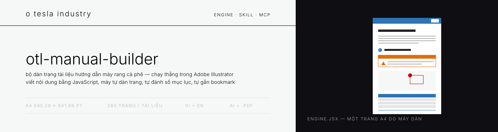
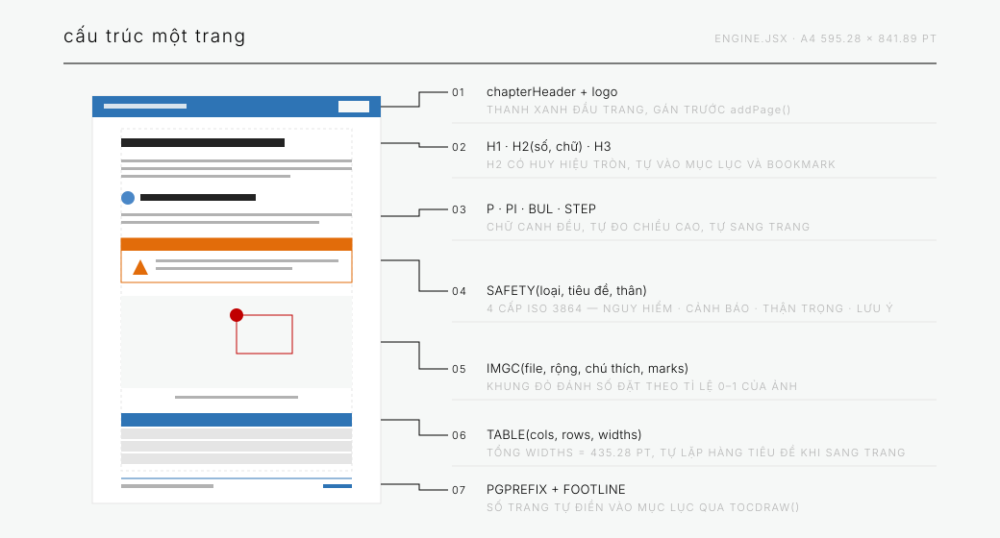
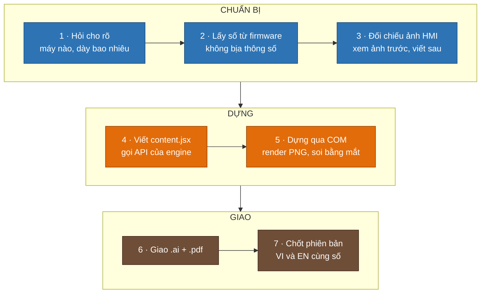

<div align="center">



<h3>Bộ dàn trang tài liệu hướng dẫn máy rang cà phê — chạy thẳng trong Adobe Illustrator</h3>

<p>Viết nội dung bằng JavaScript, máy tự dàn trang A4 đúng chuẩn bộ manual O Tesla:<br>
bìa, mục lục tự đánh số trang, hộp cảnh báo ISO 3864, bảng tự lặp tiêu đề, ảnh có khung chú thích đánh số.</p>

<p>


</p>

<samp>A4 595.28 × 841.89 pt · tối đa 280 trang / tài liệu · song ngữ VI + EN · xuất .ai và .pdf</samp>

</div>

---

## ☕ Vì sao có kho này

Mỗi máy rang giao đi phải kèm một quyển hướng dẫn. Dàn tay trong Illustrator thì một chương
15 trang mất cả buổi, và lần sau sửa một dòng là phải đẩy lại toàn bộ bố cục bên dưới.

Kho này chứa **engine dàn trang** + **skill cho trợ lý AI**. Người viết chỉ lo nội dung:

```javascript
COVER("HƯỚNG DẪN SỬ DỤNG", "Chức năng làm nóng máy", "Máy rang OTL-06 / OTL-12",
      "O TESLA INDUSTRY", "Phiên bản 1.0");
COMPANY("CÔNG TY TNHH CÔNG NGHIỆP O TESLA", "Nhà sản xuất máy rang cà phê", thongTin, luuY1, luuY2);
TOCRESERVE();

chapterHeader = "Làm nóng máy"; addPage();
H1("LÀM NÓNG MÁY TRƯỚC KHI RANG");
H2(1, "Khi nào cần làm nóng");
P("Máy nguội qua đêm phải được làm nóng trước mẻ đầu tiên…");
SAFETY("canhbao", "BỀ MẶT NÓNG",
       "Vỏ trống và ống khói đạt trên 200 độ C.\n- Không chạm tay trần\n- Đeo găng chịu nhiệt");
TABLE(["Bước", "Việc phải làm", "Thời gian"], rows, [70, 280, 85.28]);

TOCDRAW("MỤC LỤC", "PH-");
```

Engine tự đo chiều cao từng khối chữ, tự sang trang, tự điền số trang vào mục lục.
**Không ai phải tính toạ độ `y` bằng tay.**

<div align="center">

</div>

---

## 🏭 Quy trình 7 bước



> [!IMPORTANT]
> Bước 5 là bắt buộc. Lỗi tràn khung và chồng chữ **không bao giờ hiện ra trong log** —
> phải render từng trang ra PNG và nhìn bằng mắt.

---

## ⚙️ Chạy thử trong 3 lệnh

<details>
<summary><b>Yêu cầu máy</b> — Windows + Illustrator + Python (bấm để mở)</summary>

<br>

| Thứ cần có | Ghi chú |
|---|---|
| Adobe Illustrator | CC 24 trở lên, đã chạy ít nhất một lần |
| Windows PowerShell | để gọi COM `Illustrator.Application` |
| Font Arial | có đủ dấu tiếng Việt — **Arial Black thì không**, đừng dùng cho tiêu đề tiếng Việt |
| Python + PyMuPDF | `pip install pymupdf` — chỉ để render PDF ra PNG mà soi |

</details>

```bash
# 1 · nối engine với nội dung
cat skill/manual-otl/assets/engine.jsx content.jsx > manual.jsx
```

```powershell
# 2 · chạy qua COM (Illustrator tự mở nếu chưa chạy)
$ai = New-Object -ComObject Illustrator.Application
while ($ai.Documents.Count -gt 0) { $ai.ActiveDocument.Close(2) }   # dọn doc lỗi của lần trước
$ai.DoJavaScriptFile("C:\OTL\manual\build\manual.jsx")
```

```bash
# 3 · render ra PNG để soi bố cục
python -c "import fitz; d=fitz.open('ten.pdf'); [d[i].get_pixmap(dpi=78).save('p_%02d.png' % (i+1)) for i in range(d.page_count)]"
```

Script trả về `OK pages=N | thieu anh: ...` — ảnh nào chưa có thì engine vẽ ô nét đứt thay chỗ,
tài liệu vẫn dựng được khi ảnh chưa đủ.

---

## 📐 API của engine

| Hàm | Dùng để |
|-----|---------|
| `COVER(kicker, title, subtitle, machine, footline)` | Trang bìa — gọi **đầu tiên**, thay cho `newDoc()` |
| `coverImage = "ten-anh.png"` | Ảnh máy in lên bìa — đặt **trước** `COVER()` |
| `COMPANY(tên, mô_tả, [[nhãn, giá_trị], …], tiêu_đề_lưu_ý, thân_lưu_ý)` | Trang thông tin nhà sản xuất |
| `TOCRESERVE()` … `TOCDRAW(tiêu_đề, "PH-")` | Mục lục — giữ chỗ ngay sau trang công ty, số trang tự điền từ các `H1` |
| `chapterHeader = "…"; addPage();` | Sang trang mới — gán header **trước** `addPage` |
| `H1` · `H2(số, chữ)` · `H3` | Tiêu đề chương · mục có huy hiệu tròn xanh · tiêu đề nhỏ |
| `P` · `PI` · `BUL([…])` | Đoạn canh đều · ghi chú nghiêng xám · danh sách gạch đầu dòng |
| `STEP(n, chữ)` · `STEPIMG(n, chữ, file, chữ_sau, rộng)` | Bước đánh số · bước có ảnh nút bấm bên dưới |
| `IMG(file, rộng, chú_thích)` | Ảnh căn giữa |
| `IMGC(file, rộng, chú_thích, marks, legend)` | Ảnh + khung đỏ đánh số; `marks=[[x,y,w,h,"1"],…]` theo **tỉ lệ 0–1** |
| `TABLE(cols, rows, widths)` | Bảng — tổng `widths` = 435.28, tự lặp hàng tiêu đề khi sang trang |
| `SAFETY(loại, tiêu_đề, thân)` | Hộp cảnh báo 4 cấp |
| `STATEFLOW([[tên, mô_tả, thời_gian], …])` | Sơ đồ các bước nối bằng mũi tên |
| `RULE()` · `GAPV(h)` | Đường kẻ ngang · chừa khoảng trắng |

---

## 🎨 Bảng màu

<table>
<tr>
<td></td>
<td><code>46, 116, 181</code></td><td>Xanh OTL — header, footer, tiêu đề bảng</td>
</tr>
<tr>
<td></td>
<td><code>74, 135, 199</code></td><td>Xanh huy hiệu — số mục, sơ đồ trạng thái</td>
</tr>
<tr>
<td></td>
<td><code>192, 0, 0</code></td><td>Đỏ — hộp NGUY HIỂM, khung chú thích trên ảnh</td>
</tr>
<tr>
<td></td>
<td><code>226, 108, 10</code></td><td>Cam — hộp CẢNH BÁO</td>
</tr>
<tr>
<td></td>
<td><code>255, 192, 0</code></td><td>Vàng — hộp THẬN TRỌNG (chữ tiêu đề đen)</td>
</tr>
<tr>
<td></td>
<td><code>35, 35, 35</code></td><td>Chữ thân bài</td>
</tr>
</table>

### Bốn cấp cảnh báo — ISO 3864 / ANSI Z535

| Cấp | Màu | Khi nào dùng |
|---|---|---|
| 🟥 **NGUY HIỂM** | đỏ | Chết người hoặc thương tích nặng, gần như chắc chắn xảy ra nếu làm sai — ví dụ nổ khí gas |
| 🟧 **CẢNH BÁO** | cam | Có thể chết người hoặc thương tích nặng — bề mặt nóng, máy tự khởi động |
| 🟨 **THẬN TRỌNG** | vàng | Thương tích nhẹ hoặc hỏng máy |
| 🟦 **LƯU Ý** | xanh | Không nguy hiểm, chỉ ảnh hưởng chất lượng mẻ rang hoặc tuổi thọ máy |

Mỗi hộp viết **hậu quả trước**, rồi mới tới các gạch đầu dòng nêu việc phải làm.

---

## 🔧 Bẫy đã trả giá

> [!CAUTION]
> **Canvas của Illustrator chỉ 16384 pt.** Xếp artboard một hàng ngang là gãy từ trang 13
> với lỗi `AOoC`. Engine xếp theo lưới. Tài liệu trên 100 trang thì dời gốc lưới
> (`OX = -7700, OY = 4500`, `COLS = 20`) → chứa được 280 trang. Đừng đẩy `OY` sát mép trên,
> vì hàm đo chiều cao chữ đặt khung tạm ở `y = -3000…-4000`.

> [!WARNING]
> **Không sửa file `.jsx` tiếng Việt bằng `sed` hay `perl -i`** — hỏng encoding UTF-8 và nuốt
> escape `\uXXXX`. Ghi lại nguyên file bằng Python đọc/ghi UTF-8.

> [!NOTE]
> - `textFrame.paragraphs[0]` ném lỗi **1302** khi khung chữ rỗng → luôn bọc `try/catch` quanh `textRange.paragraphAttributes`.
> - `position` của text frame là **góc trái-trên**, không phải baseline — tính theo baseline là chữ tụt nửa dòng khỏi thanh màu.
> - Chữ canh đều phải dùng `FULLJUSTIFYLASTLINELEFT`, không phải `FULLJUSTIFY` — nếu không, dòng cuối mỗi đoạn bị kéo giãn hết chiều ngang.

---

## 📁 Cây thư mục

<details>
<summary>bấm để mở</summary>

```
otl-manual-builder/
├── README.md
├── CHANGELOG.md
├── assets/banner/
│   ├── banner.svg              ← ảnh đầu trang
│   └── trang-mau.svg           ← sơ đồ cấu trúc trang
└── skill/manual-otl/           ← thả nguyên thư mục này vào ~/.claude/skills/
    ├── SKILL.md                ← chỉ dẫn cho trợ lý AI
    ├── assets/
    │   └── engine.jsx          ← bộ dàn trang, ~22 KB
    └── references/
        ├── style-otl.md                ← khổ, lề, cỡ chữ, màu
        ├── quan-ly-phien-ban.md        ← đánh số phiên bản, tài liệu song ngữ
        ├── content-mau-preheat.jsx     ← chương 15 trang đã giao khách (VI)
        └── content-mau-preheat-EN.jsx  ← bản tiếng Anh cùng phiên bản
```

</details>

### Dùng làm Agent Skill

Chép `skill/manual-otl` vào `~/.claude/skills/` là xong — trợ lý sẽ tự gọi skill khi bạn nói
*"làm hướng dẫn sử dụng"*, *"thêm chương vào manual"*, hay đưa ảnh chụp màn hình HMI kèm yêu
cầu soạn tài liệu.

---

## 📏 Quy tắc nội dung

> [!IMPORTANT]
> **Thông số đọc thẳng từ nguồn thật — không lấy từ trí nhớ.** Số nào không tra được thì hỏi,
> đừng đoán. Một con số sai trong tài liệu vận hành là một sự cố ngoài xưởng.

- Tài liệu đã giao khách **không sửa đè lặng lẽ**: sửa nhỏ `1.0 → 1.1`, sửa nội dung vận hành / an toàn / thông số `1.1 → 2.0`.
- Số phiên bản phải khớp **ba chỗ**: chân trang bìa, trang công ty, và bảng lịch sử.
- **VI và EN luôn cùng một phiên bản** — sửa một bên là dựng lại cả hai, không có ngoại lệ.
- Bộ trang chuẩn: bìa → trang nhà sản xuất → mục lục → nội dung → phụ lục. Thiếu một trong ba trang đầu là chưa giao được.
- Giọng văn cho thợ vận hành: câu ngắn, chủ ngữ rõ. Tên nút và tên ô giữ **nguyên tiếng Anh như trên HMI** (Set temp, Bean temp, Burner, Airflow) để nhìn máy là khớp ngay.

---

<div align="center">

### CÔNG TY TNHH CÔNG NGHIỆP O TESLA

Máy rang cà phê · tủ điện · tự động hoá

📍 VP: 44 Đường N5, KP. Tân Phước, P. Tân Đông Hiệp, TP. HCM<br>
🏭 Nhà máy: 398/33 ĐT743B, KP Đông Thành, P. Tân Đông Hiệp, TP. HCM<br>
📞 0936 198 938 · 💬 WhatsApp +84 936 198 938 · ✉️ otlpro.com@gmail.com

<br>

<samp>Made with ☕ and 🔧 — O Tesla Industry</samp>

</div>
