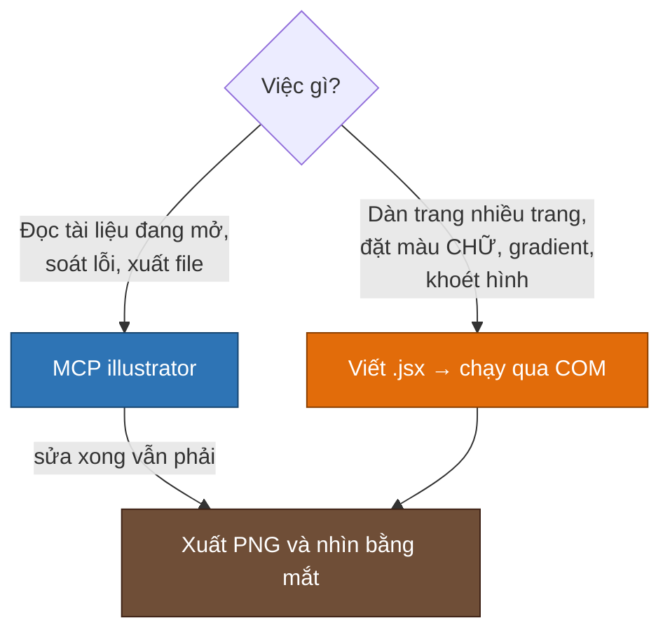

# MCP Illustrator — lái Illustrator bằng câu lệnh

Engine dàn trang chạy được mà không cần MCP. Nhưng khi làm **bìa, banner, sơ đồ, ảnh minh
hoạ** — những thứ phải nhìn rồi sửa — thì MCP tiện hơn hẳn: trợ lý đọc được tài liệu đang mở,
biết khung chữ nào màu gì, vật thể nào nằm ngoài artboard.

Máy chủ MCP dùng ở đây là **[`illustrator-mcp-server`](https://github.com/ie3jp/illustrator-mcp-server)**
của ie3jp (MIT, 66 tool). Kho này **không chép lại mã nguồn** của gói đó — `npx` tự tải về.
Phần dưới là cấu hình + những gì O Tesla đã trả giá để biết.

---

## Cài đặt

```bash
claude mcp add illustrator --scope user -- npx -y illustrator-mcp-server
```

Hoặc dán thẳng vào cấu hình MCP — xem [`illustrator.mcp.json`](illustrator.mcp.json):

```json
{
  "mcpServers": {
    "illustrator": {
      "type": "stdio",
      "command": "npx",
      "args": ["-y", "illustrator-mcp-server"],
      "env": {}
    }
  }
}
```

> [!WARNING]
> Cờ `-y` là **bắt buộc**. Thiếu nó thì `npx` dừng lại hỏi *Ok to proceed?* trong khi không ai
> trả lời được, và máy chủ MCP treo im không báo lỗi.

Yêu cầu: Windows hoặc macOS, Adobe Illustrator CC trở lên, đã mở ít nhất một lần.

---

## 66 tool, chia theo việc

| Nhóm | Tool hay dùng |
|---|---|
| **Tài liệu** | `create_document` · `open_document` · `save_document` · `close_document` · `get_document_info` · `get_document_structure` · `undo` |
| **Đọc hiện trạng** | `get_layers` · `get_path_items` · `list_text_frames` · `get_text_frame_detail` · `get_colors` · `get_artboards` · `get_groups` · `get_symbols` · `get_images` · `get_effects` · `find_objects` · `get_selection` |
| **Vẽ** | `create_rectangle` · `create_ellipse` · `create_line` · `create_path` · `create_text_frame` · `create_path_text` · `create_gradient` · `place_image` · `place_symbol` |
| **Sửa** | `modify_object` · `move_to_layer` · `group_objects` · `ungroup_objects` · `duplicate_objects` · `delete_objects` · `align_objects` · `set_z_order` · `convert_to_outlines` · `replace_color` |
| **Hệ thống thiết kế** | `extract_design_tokens` · `apply_text_style` · `apply_graphic_style` · `list_text_styles` · `list_graphic_styles` · `place_style_guide` · `place_color_chips` · `check_contrast` · `check_text_consistency` · `set_workflow` |
| **In ấn & xuất** | `export` · `export_pdf` · `create_crop_marks` · `preflight_check` · `manage_artboards` · `manage_linked_images` · `manage_datasets` · `list_fonts` · `set_illustrator_version` |

---

## Ranh giới: khi nào MCP, khi nào JSX qua COM



Chạy một file `.jsx` qua COM khi Illustrator **đang mở sẵn**:

```powershell
$ai = [Runtime.InteropServices.Marshal]::GetActiveObject("Illustrator.Application")
$ai.DoJavaScriptFile("C:\OTL\manual\build\viec.jsx", $null, 2)
```

Còn khi muốn Illustrator tự mở nếu chưa chạy thì dùng `New-Object -ComObject` như trong
[README chính](../README.md#-chạy-thử-trong-3-lệnh).

---

## Bốn bẫy đã trả giá

> [!CAUTION]
> **1 · Đặt màu chữ qua MCP KHÔNG ăn.** `create_text_frame(fill=…)` và `modify_object(fill=…)`
> chỉ ghi màu vào *khung* text — `characterAttributes.fillColor` của từng ký tự vẫn đen, xuất ra
> là chữ đen thui. Gọi `get_text_frame_detail` sẽ thấy sự thật (`rgb 0,0,0`). Đặt fill lên
> `group` cũng vô tác dụng.
> **Cách đúng:** viết `.jsx` đặt `textRange.characterAttributes.fillColor` rồi chạy qua COM.

> [!WARNING]
> **2 · Arial Black không có glyph tiếng Việt.** Gặp chữ `Ừ` là Illustrator âm thầm thay
> Myriad Pro cho đúng một ký tự, cả từ lệch nét mà không báo gì. Tiêu đề tiếng Việt dùng
> **Segoe UI** (`SegoeUIBlack` / `SegoeUI-Bold` / `SegoeUI` / `SegoeUI-Italic`) hoặc **Arial**
> thường. Máy dựng manual **không có Montserrat**.

> [!CAUTION]
> **3 · Artboard có Y DƯƠNG.** `artboardRect = [0, 800, 1200, 0]` — `top = H`, `bottom = 0`,
> không phải Y âm như MCP quy đổi ở chế độ *document*. Trong JSX: `Y = H - yWeb`.
> Giả định sai dấu một lần đã khiến bộ lọc "xoá vật thể ngoài artboard" quét sạch logo rồi lưu
> đè. **Luôn đọc `artboards[0].artboardRect` trước khi tính toạ độ, và đừng lưu đè trước khi
> xem lại kết quả.**

> [!NOTE]
> **4 · Khoét hình (knockout) phải dùng Pathfinder Subtract + ép z-order.**
> `executeMenuCommand("compoundPath")` ăn theo chiều vẽ nên không đáng tin: nền vẽ bằng
> `ellipse()` thì thủng, cùng hình đó vẽ bằng `roundedRectangle()` thì đặc. Ép `evenodd` hay
> `polarity = NEGATIVE` lên từng subpath đều vô tác dụng.
>
> ```javascript
> sel([ground, cut]);
> app.executeMenuCommand("group");
> ground.zOrder(ZOrderMethod.SENDTOBACK);   // BẮT BUỘC — thiếu là ra union, không phải trừ
> app.executeMenuCommand("Live Pathfinder Subtract");
> app.executeMenuCommand("expandStyle");
> ```
>
> `expandStyle` trả về **GroupItem lồng nhau**, nên `result.pathItems.length` ra `0` —
> đừng lấy đó làm dấu hiệu thất bại, phải xuất PNG ra nhìn mới biết đúng sai.

Mẹo lặt vặt:

- Gradient trùng `g.name` thì ném *the name is in use* — thêm hậu tố ngẫu nhiên.
- `replace_color` có `scope` theo layer thì trả `0` (lỗi của gói); bỏ `scope`, chạy toàn tài
  liệu thì đúng. `replace_color` và `find_objects` đều **không đệ quy** vào group và
  compound path khi có `scope`.

---

<div align="center">
<samp>Số tool và tên tool theo illustrator-mcp-server 1.10.3 · MIT © ie3jp</samp>
</div>
